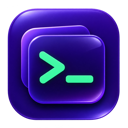
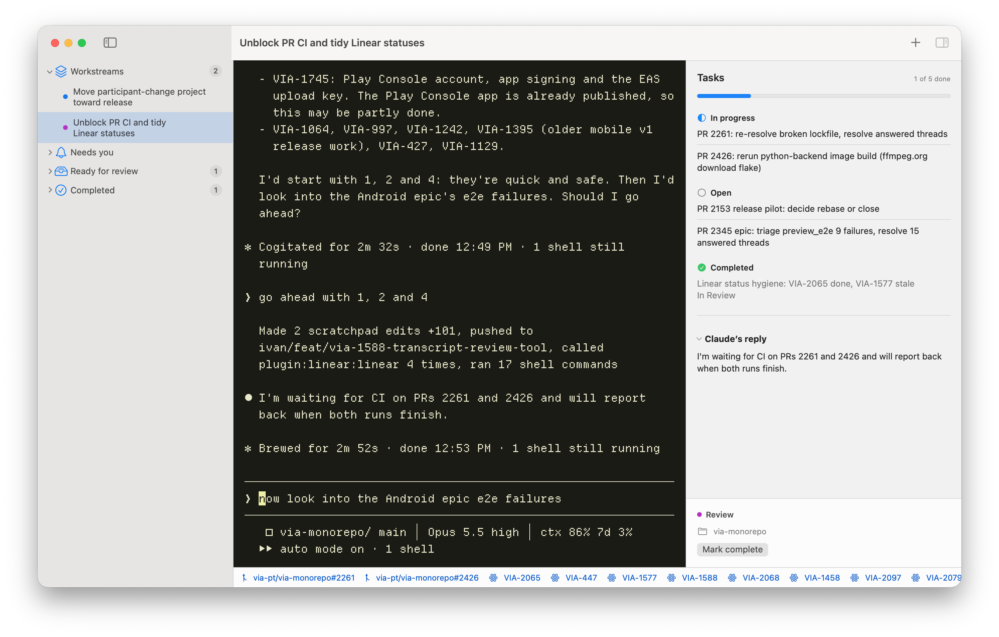

<p align="center"></p>
<h1 align="center">Muxteroid</h1>
<p align="center">A native Mac app for running Claude Code and Codex CLI workstreams at once.</p>

Each workstream has a persistent terminal, a task list the agent maintains in Beads, and links to the pull requests and Linear issues it touches. When one session asks for permission or finishes a turn, it appears under **Needs you** or **Ready for review** in the sidebar.



## Try it on your Mac

You'll need macOS 15 or later, a Swift 6.2 or newer toolchain, Homebrew, and a signed-in [Claude Code](https://code.claude.com/docs/en/quickstart) or [Codex CLI](https://developers.openai.com/codex/cli/) installation. Codex support was tested with CLI 0.162.1 and requires app-server Unix sockets and remote TUI support.

```sh
brew install beads dtach
git clone https://github.com/katspaugh/muxteroid.git
cd muxteroid
./build.sh
open build/Muxteroid.app
```

Press **⌘N**, choose your agent and working folder, and click **Create**. Give the agent a task in the terminal. It names the stream from the goal and updates the title as the work becomes clearer. A Linear reference is optional.

## Working across streams

- **Switch away while your agent works.** Each session runs in its own PTY. Switch streams or quit Muxteroid and the agent process keeps running. After a reboot, Muxteroid can resume from the saved conversation.
- **See what's waiting on you.** Permission requests, questions, and errors appear under **Needs you**. Allow notifications at launch to get a macOS alert when a workstream or subagent needs input. Click it to return to the workstream. Alerts run while Muxteroid is open, including in the background. Completed turns appear under **Ready for review**, with the agent’s formatted reply in the inspector. You decide when to mark the workstream complete.
- **Inspect delegated work.** Expand a workstream in the sidebar to see its Claude subagents. Select a subagent to switch the embedded terminal to Claude Code’s own agent view. Select the parent to return to the conversation. This requires Claude Code 2.1.300 or later and a workstream terminal started with this version of Muxteroid. Older sessions and agents Claude has unloaded open as transcript snapshots in a terminal pager.

  Muxteroid loads a local Claude mod in each workstream. On first use it creates a Claude Chat shortcut (`ctrl+x ctrl+y` → `command:muxteroid-view`) if no keybindings file exists. If you already have a keybindings file, add that binding to its Chat section or run `/muxteroid-view` after selecting an agent.
- **Follow the plan.** Each agent uses [Beads](https://github.com/gastownhall/beads) to track subtasks, dependencies, and blockers under the workstream. The inspector shows progress. Press **⌥⌘I** to give the terminal the full width.
- **Jump to related work.** The bottom bar collects GitHub PRs and Linear issues from agent activity. The links stay with the stream when you reopen it.

## How it runs

Muxteroid uses SwiftUI and an embedded [Ghostty terminal](https://github.com/Lakr233/libghostty-spm). If Ghostty is installed, Muxteroid reads its appearance settings, including its font and colors. The embedded build does not render custom shaders. [dtach](https://github.com/crigler/dtach) keeps the process alive between attachments; scrollback belongs to the current terminal view.

Workstream data lives in `~/Library/Application Support/Muxteroid`. Each Codex workstream runs its own local app-server behind a private Unix socket. Its terminal and Muxteroid observe the same thread, including approval requests, questions, replies, and loaded subagents. Selecting a Codex subagent opens its thread in a Codex terminal. Each Claude session receives its parent Beads issue and [hooks](https://code.claude.com/docs/en/hooks) for reporting activity. Muxteroid uses the working folder you choose. For parallel changes to the same repository, choose a separate Git worktree for each stream.

## Support

[](https://www.paypal.com/donate/?business=ivan.kalyaev%40gmail.com)

Muxteroid's source is available under the [MIT License](LICENSE).
