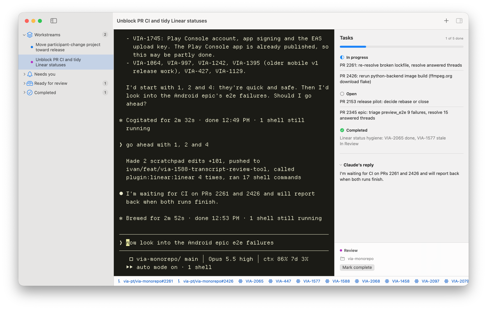

<p align="center"></p>
<h1 align="center">Meridian</h1>
<p align="center">A native Mac app for running Claude Code and Codex CLI workstreams at once.</p>

Meridian is the spirit of the workspace: connecting you and your agents, keeping context together, and helping work move forward.

Each workstream has persistent terminals, a shared task list the agents maintain in Beads, and links to the pull requests and Linear issues it touches. Terminals can run Claude, Codex, or a plain shell in the same folder and worktree.



## Try it on your Mac

You'll need macOS 15 or later, a Swift 6.2 or newer toolchain, Homebrew, and a signed-in [Claude Code](https://code.claude.com/docs/en/quickstart) or [Codex CLI](https://developers.openai.com/codex/cli/) installation. Codex support was tested with CLI 0.162.1 and requires app-server Unix sockets and remote TUI support.

```sh
brew install beads dtach
git clone https://github.com/katspaugh/meridian.git
cd meridian
./build.sh
open build/Meridian.app
```

`build.sh` signs the app ad hoc by default, so macOS asks again for access to folders such as Documents after every rebuild. To keep those permissions, sign with a stable identity from your keychain, for example `export MERIDIAN_SIGN_IDENTITY="Apple Development"`. Run `security find-identity -v -p codesigning` to list your identities.

Press **⌘N**, choose your agent and working folder, and click **Create**. Give the agent a task in the terminal. It names the stream from the goal and updates the title as the work becomes clearer. A Linear reference is optional.

The folder field starts with your last used folder. Below it, **Recent folders** lists up to eight project folders, most recent first; click one to select it. The list is remembered across launches and skips folders that no longer exist.

For Git repositories, creating a workstream automatically creates a fresh `meridian/<id>` branch and worktree from the selected checkout’s current commit. A selected subfolder is preserved. Uncommitted changes stay in the original checkout. Both agents and any extra terminals share this one worktree. Folders outside Git are used directly; existing workstreams retain their current folders.

## Working across streams

- **Switch away while your agent works.** Each session runs in its own PTY. Switch streams or quit Meridian and the agent process keeps running. After a reboot, Meridian can resume from the saved conversation.
- **Open another terminal in a stream.** Use the **+** beside the terminal tabs to add a plain terminal, Claude, or Codex. Each terminal has its own session and status; all share the workstream’s folder, worktree, Beads tasks, and links. The app remembers your selected tab. Switching tabs keeps their output in place. After a reboot, use **Start terminal** on the tab to resume an agent or start a fresh shell.
- **Exit an agent or close a tab.** Exiting Claude or Codex with **Ctrl+D** leaves a plain shell in the same tab and worktree. **Ctrl+D** at an empty shell prompt closes that tab. **⌘W** closes the selected terminal and its session directly; you can also choose **Close Terminal** from the tab’s context menu. Closing the last tab keeps the workstream and tasks available, with **+** to open another terminal.
- **Quit the app.** **⌘Q** quits Meridian immediately without a confirmation, including while a terminal has focus. Running sessions, worktrees, and Beads tasks remain available when you reopen it. Terminal scrollback is not saved across app restarts.
- **See what's waiting on you.** Permission requests, questions, errors, and workstreams with blocked Beads tasks appear under **Needs you**. Blocked tasks show **Why it’s blocked** and **To unblock** in the inspector and sprint board, including the concrete action needed from you (or what you are waiting for). Older tasks retain their recorded notes and prompt you to ask the agent for the missing next step; these streams return to **Ready for review** once their blockers are cleared if the agent is still awaiting review. Allow notifications at launch to get a macOS alert when a workstream or subagent needs input. Click it to return to the workstream. Alerts run while Meridian is open, including in the background. Completed turns appear under **Ready for review**, with the agent’s formatted reply in the inspector. You decide when to mark the workstream complete.

  Terminal tabs identify the session needing input, and notifications select that terminal. The inspector shows the selected terminal’s reply alongside the shared tasks. A stream appears under **Ready for review** once no agent is working or awaiting input; an idle shell does not prevent it. Completion remains a workstream-level action.
- **Inspect delegated work.** Expand a workstream in the sidebar to see its Claude subagents. Select a subagent to switch the embedded terminal to Claude Code’s own agent view. Select the parent to return to the conversation. This requires Claude Code 2.1.300 or later and a workstream terminal started with this version of Meridian. Older sessions and agents Claude has unloaded open as transcript snapshots in a terminal pager.

  Meridian loads a local Claude mod in each workstream. On first use it creates a Claude Chat shortcut (`ctrl+x ctrl+y` → `command:meridian-view`) if no keybindings file exists. If you already have a keybindings file, add that binding to its Chat section or run `/meridian-view` after selecting an agent.
- **See the sprint board.** Click **Sprint board** in the sidebar or press **⇧⌘B** to see all workstreams and their Beads tasks grouped by status. Search streams or tasks, hide completed workstreams, and click a task or stream to open its terminal. The board updates as agents maintain their tasks.
- **Follow the plan.** Each agent uses [Beads](https://github.com/gastownhall/beads) to track subtasks, dependencies, and blockers under the workstream. The inspector shows progress. Press **⌥⌘I** to give the terminal the full width.
- **Follow a Superpowers run.** If you use the [Superpowers](https://github.com/obra/superpowers) plugin, the inspector shows the run above the tasks: brainstorm, plan, each plan task with its implement and review steps, final review, verify, PR, CI, and merge, with the time each finished and an estimate for what is left. The step that is waiting on you is marked. Below the timeline are the specs and plans written in this workstream; click one to read it in its own window, or open it in your editor from there. Meridian uses the Superpowers installation you already have. Claude terminals report each step as it happens; Codex terminals are followed through the spec, plan, and task-progress files and the commands of each finished turn, so their timeline updates at the end of a turn. PR checks are read with `gh` about once a minute. Right-click **Pipeline** and choose **Clear Pipeline** to forget a run; marking the workstream complete freezes it.
- **Check account usage.** The bottom bar shows Claude and Codex usage percentages and reset countdowns directly. Hover for window labels or click refresh. Meridian queries Claude Code for current limits, falling back to recent measurements if needed. If Claude shows “Sign in,” run `claude auth login` in your terminal, then refresh.
- **Jump to related work.** Meridian collects GitHub PRs and Linear issues from agent activity. Pull requests appear under **Changes** in the inspector with their title, lines added and removed, and check status: a green dot once every check passes, red when one fails, and a finished count such as 5/6 while checks run. Click a row to open the PR, or use **…** to copy its link. Details come from the GitHub CLI, so install and sign in to [`gh`](https://cli.github.com); without it each PR is a plain link. The inspector lists additional Linear links under **Related issues**. The links stay with the stream when you reopen it.

- **Start from GitHub.** Paste a GitHub issue or PR URL into **New workstream** to return to a linked stream. For new work, choose a checkout of the repository. A PR gets an isolated branch at its head commit, including PRs from forks. An issue supplies the workstream title and brief.
- **Follow up on a PR.** Expand a failed check in **Changes** to open its job or send it to the selected idle agent. For GitHub Actions, the handoff includes available failed steps, a log excerpt, and the job commit. Expand unresolved review threads to send one comment with its source location and link. The sprint board shows direct review requests for your signed-in GitHub account, requested changes, and merge conflicts beside the relevant workstream.

## Comment follow-ups

While Meridian is open and its soul is unpaused, it checks for new comments about every five minutes (and during other sweeps). It routes actionable feedback by saved PR and Linear issue links, including completed workstreams. It reopens completed streams when more work is needed, restarts an offline agent, and keeps feedback queued until the agent is idle and off screen. Acknowledgements and resolved Linear threads are ignored. When several workstreams match, Meridian picks one automatically, preferring an active stream with an agent. Only comments without a match appear under **Comment follow-ups** in the sidebar, with the source link and a button to open a new workstream. Provider errors appear there too.

Merge conflicts count as feedback too. On the same schedule, Meridian searches every open pull request you authored. When GitHub reports a conflict with the base branch, the agent in the linked workstream is asked to merge the base branch into the PR branch, resolve the conflicts, run the tests and push, without rebasing or force-pushing. Each conflicting head commit is sent once. A conflict that clears before delivery is dropped. Search results don't say whether a PR is mergeable until GitHub has computed it, and GitHub computes that only when someone requests the PR on its own. So Meridian requests up to ten such PRs on each poll, which starts the computation. If the answer is already available, it is used right away. Otherwise the next poll picks it up. While mergeability is unknown, a queued conflict stays queued. If no workstream links the PR, Meridian opens one, as **New workstream** does for a pasted PR URL. It uses a local checkout of that repository that another workstream already uses, together with that workstream's agent, and starts the agent. Without a known checkout, the PR appears under **Comment follow-ups** instead.

GitHub monitoring uses the signed-in `gh` account: linked PR discussion, inline review comments and review summaries, plus issues and PRs in your notifications. The [notifications API](https://docs.github.com/en/rest/activity/notifications) requires `repo` or `notifications` access. Meridian never marks notifications read or posts external replies.

Open **Meridian → Settings…** (⌘,) to save or replace a Linear key, test either connection, pause the soul, or turn comment watching on and off. Keys are verified before saving. Removing a key requires confirmation.

Linear monitoring uses the macOS Keychain generic password with service `local.meridian.linear` and account `comments`, or `LINEAR_API_KEY` in the app's environment (which takes precedence), using a [personal API key with read access](https://linear.app/developers/graphql). It watches linked issues, issues you created or are assigned to, and comments mentioning your Linear user ID. Only comments visible to that key can be read. A Keychain credential also works when Meridian launches from Finder. An MCP login in an agent does not supply credentials to the app. To launch with the variable already exported in your shell, quit Meridian and run `/Applications/Meridian.app/Contents/MacOS/Meridian` from that shell. Do not put the key in repository files or manager notes.

The first poll establishes a baseline rather than replaying historical discussions. Subsequent checkpoints and queued feedback survive app restarts; failed requests retain their checkpoint for retry. Turn off **Watch Linear and GitHub comments** in Settings to disable comment watching while keeping other soul behavior. Settings override the legacy `watch_comments` value in `manager/config.json`. Pausing the soul also pauses watching and delivery.

To limit GitHub watching to some repositories, list them in `manager/config.json` under Meridian's data folder. Without the key, Meridian watches every repository. An empty list watches none.

```json
{
  "github_repositories": ["owner/repo"],
  "review_requests": {"owner/repo": "/path/to/local/checkout"}
}
```

## Review requests

For each repository in `review_requests` that is also in scope, Meridian checks open PRs that request your review directly. Requests to your teams are skipped. A new request opens a workstream from the local checkout at the PR head. This happens only when the author is an owner, member or collaborator and the branch is in the same repository. Other requests appear as a Manager question with the link. The review agent loads only your user Claude settings, never the project settings or hooks from the PR branch. Its Claude agent is told to submit one review with the COMMENT event and inline comments. The agent must never approve, request changes, merge or push. The agent posts with your `gh` account, so approve its permission prompt if one appears. Meridian closes the workstream when your review appears on GitHub or the PR closes, once the agent has finished its turn. If the PR already has a workstream you opened, Meridian asks you in Manager instead of starting a review there. Other comments on that PR never reach the review workstream, so its agent does not reply on your behalf. A repeat request reopens the earlier review workstream and asks for a review of the latest head. The first check records existing requests without starting work. Review watching shares the comment-watching setting and the soul's pause.

## Working from Linear

Open **Settings** (⌘,) and save a personal Linear API key in macOS Keychain. Give the key read access to the teams you work with. Posting questions requires comment creation, and sharing review attachments requires write access.

- **Start or resume.** In **⌘N**, paste an issue ID or URL. Check the title, status, and assignee. **Create** opens a workstream with the description and recent discussion in the first agent prompt. A match offers **Resume workstream** or **Reopen workstream**. If lookup fails, you can still save the reference and start an ordinary stream.
- **Review changed requirements.** The inspector pins the primary issue above the Beads plan. Opening the inspector refreshes its cached copy. In a stream without a primary reference, open **Related issues → Set primary issue** and choose an issue. Expand the description for acceptance criteria. Changed fields and description edits stay highlighted until you click **Mark reviewed**.
- **Approve Linear posts.** Linear syncs to Slack, so agents never post there by themselves. Agents are told to treat every Linear write as a draft: comments, replies, issue edits, status changes and new issues. In a Claude terminal, any Linear MCP tool other than a read (`get_`, `list_`, `search_`, `extract_`, `whoami`) waits for you in a permission prompt that shows the draft. Terminals never receive `LINEAR_API_KEY`. The bridge's `linear-ask` and `linear-share` commands run only when their parent process is this bundle's Meridian executable, as the kernel reports it (not `argv`), which is how the app's buttons start them, so an agent cannot post through them from its shell. Bash commands that name `api.linear.app`, Meridian's Linear Keychain entry, `linear-ask` or `linear-share` also wait for you, even when quoted or split across lines. This shell check is best effort: a script file that calls the API itself is not caught. The terminal shows **Needs you** until you allow or reject the draft. Meridian's manager never answers these prompts, even in auto mode or when paused. Codex terminals have no hooks, so there the rule is an instruction only: the agent shows the draft and waits for your approval. Follow-ups for Linear comments remind the agent to draft its reply. GitHub replies are still posted directly.
- **Get a decision.** Click **Ask on Linear** beside a Manager question. Reply in the resulting thread. While comment watching is enabled and the soul is unpaused, Meridian checks for replies about every 45 seconds. The answer appears under **Linear replies** and in the Manager activity log. An eligible idle agent receives a prompt to read it. Answers stay available for the next turn when the terminal is busy or showing a dialog.
- **Hand off a PR.** In **Changes**, click **Share for review…**, choose a PR, and edit the verification and remaining work. **Share to Linear** publishes one review attachment for this workstream. Sharing again updates its summary and current PR link.

## How it runs

Meridian uses SwiftUI and an embedded [Ghostty terminal](https://github.com/Lakr233/libghostty-spm). If Ghostty is installed, Meridian reads its appearance settings, including its font and colors. The embedded build does not render custom shaders. [dtach](https://github.com/crigler/dtach) keeps the process alive between attachments; scrollback belongs to the current terminal view.

On upgrade, Meridian carries forward workstreams, preferences, and running terminal connections. Set `MERIDIAN_HOME` to use a different data directory.

Workstream data lives in `~/Library/Application Support/Meridian`, with managed checkouts under `worktrees/`. Each Codex terminal runs its own local app-server behind a private Unix socket. Its terminal and Meridian observe the same thread, including approval requests, questions, replies, and loaded subagents. Selecting a subagent selects its owning terminal. Each Claude session receives its parent Beads issue and [hooks](https://code.claude.com/docs/en/hooks) for reporting activity. The same hooks drive the Superpowers timeline, which Meridian stores per workstream beside its other activity data. Plain shells receive `BEADS_DIR` and `MERIDIAN_ISSUE` for the same shared task context. Adding terminals reuses the stream’s worktree. Completing a stream keeps its branch and files available; it does not remove the worktree. Meridian’s reviews run through `claude -p` on your own Claude Code login. They use the `model` set in `manager/config.json`, Fable by default. If that model hits a usage limit, Meridian retries once with `fallback_model`, Opus by default. When a review fails, the reason appears with the monitoring errors in **Comment follow-ups** and the Meridian overview. That includes the limit message Claude Code shows, but never credentials. Comments and conflicts that already have a follow-up plan are delivered even while new comments cannot be classified. Meridian’s tools are file reading and search, the web, and read-only `gh` and `bd` commands; it cannot run `git` or write files.

## Support

[](https://www.paypal.com/donate/?business=ivan.kalyaev%40gmail.com)

Meridian's source is available under the [MIT License](LICENSE).

### Talk to Meridian

Meridian’s Soul runs in an embedded Claude Code terminal. Select **Meridian** or press **⇧⌘M** to return to the same session from any workstream. It uses your local Claude Code login and settings. The first time you open Soul after upgrading from Codex, it starts a new Claude conversation. Ask it to review your workstreams, create a workstream in a project folder, or send instructions to an idle agent. **Overview** contains the briefing, pending questions, decision log, and previous chat messages. The terminal stays running when you switch views or quit the app.
